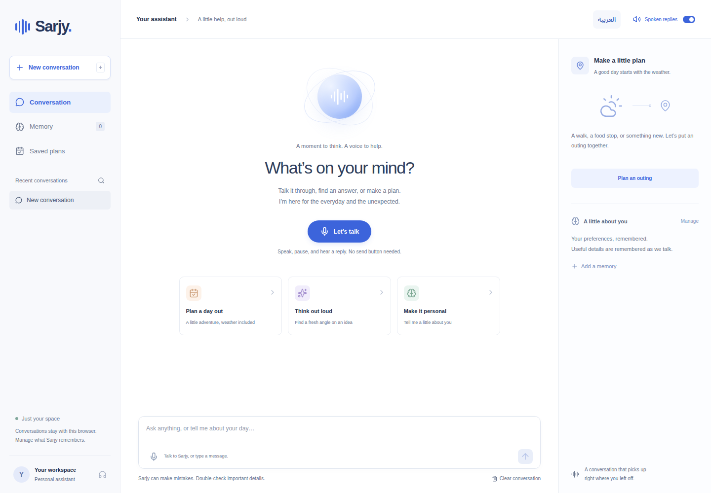

# Sarjy

[Live demo](https://sarjy.test123.pics) · [Architecture](docs/architecture.md) · [Tests](docs/testing.md)

Sarjy is an English and Arabic voice assistant with persistent memory and a weather-aware outing planner. It uses Next.js and TypeScript for the interface, FastAPI for the backend, and PostgreSQL for conversations, personal facts, and workflow state.



## Features

- **Hands-free conversation:** speak, pause, hear a reply, and continue. Speech language is detected automatically, using the system microphone.
- **Personal memory:** names, preferences, and availability carry into new conversations. Saved facts can be viewed and removed.
- **Outing planner:** collect details over several turns, check the weather, pause, make corrections, and confirm a saved plan.
- **English and Arabic:** translated navigation, right-to-left layout, and English/Saudi Arabic speech. [Arabic mobile view](docs/images/mobile-arabic.png).
- **Separate browser workspaces:** conversations, memories, and plans are scoped to the current session.

## Run locally

Install Docker Engine and Docker Compose, then:

```bash
cp .env.example .env
```

Set `POSTGRES_PASSWORD` and `GROQ_API_KEY` in `.env`, then start the app:

```bash
docker compose up --build -d --wait
```

Open [localhost:3000](http://localhost:3000). API documentation is at [localhost:3000/api/docs](http://localhost:3000/api/docs); `/api/health` checks the database connection.

The planner form, explicit memory commands, and saved history work without an AI key. General conversation, automatic fact extraction, transcription, and cloud speech require a Groq key. The English and Arabic Orpheus models also require accepting their terms in the [Groq playground](https://console.groq.com/playground).

| Setting | Purpose |
|---|---|
| `POSTGRES_PASSWORD` | Password for the local PostgreSQL database. |
| `GROQ_API_KEY` | Server-side credential for chat, Whisper, and Orpheus. |
| `APP_PORT` / `APP_ORIGIN` | Browser port and exact allowed origin; defaults to `3000` / `http://localhost:3000`. |
| `COOKIE_SECURE` | Use `true` for HTTPS; defaults to `false` locally. |
| `APP_TIMEZONE` | Timezone for relative dates; defaults to `Asia/Riyadh`. |

Model and weather-endpoint overrides are listed in [.env.example](.env.example). Keep credentials in `.env`; they are excluded from Git and Docker build contexts. Only the frontend is published by local Compose.

Use `docker compose down` to stop the stack while retaining data. Adding `-v` removes the database volume. Changing the environment password does not change the password of an already initialized PostgreSQL database.

## Try it

1. Select **Let’s talk**, allow the microphone, and say “My favorite color is blue.” Pause for the spoken reply.
2. Start a new conversation and ask “What is my favorite color?” Returning with the same browser cookie retains memory.
3. Say “Plan an outing” and provide a city, a date within the next 15 days, activities, and the number of people.
4. Pause the outing, ask an unrelated question, and resume. Correct a detail and review the updated forecast and proposal.
5. Say “Confirm plan” to save it. Ask about previous plans in another conversation or open **Saved plans**.

Switch the page between English and Arabic in the header. Speech detection stays automatic. **End voice chat** stops recording or playback; text input and **Read aloud** are also available.

## External API

Open-Meteo supplies the forecasts used by the outing planner: rain, heat, and wind affect whether the proposed activities should be indoors or outdoors. Its geocoding and forecast endpoints give the workflow a useful dependency with explicit validation, source attribution, and error recovery. The public evaluation API needs no additional credential, making the integration easy to try locally.

Groq provides chat, Whisper transcription, and Orpheus speech. Provider failures are shown as friendly recovery messages; the app does not substitute invented forecasts or mock responses at runtime.

## Workflow design

The planner keeps validated slots and an explicit state in PostgreSQL. The model can suggest changes through typed tools; Python validates the arguments and owns every transition. Confirmation is a separate user action, so a generated proposal cannot silently become a saved plan.

```text
collecting → review → confirmed
     ↕          ↕
   paused     paused

collecting / review / paused → cancelled → restart → collecting
```

Partial answers survive reloads. Off-topic questions preserve the current outing. Edits invalidate the old forecast/proposal, and weather failures preserve the new details while preventing confirmation. Forecasts older than 30 minutes need refreshing and another review.

[Architecture notes](docs/architecture.md) describe the data model, request flow, transactions, and failure handling.

## Tests

```bash
docker compose --profile test build tests
docker compose --profile test run --rm tests
cd frontend
npm ci
npm run typecheck
npm run test:audio
npx playwright install --with-deps chromium
npm run test:e2e
```

The backend suite uses a disposable PostgreSQL schema. Automated provider tests use fixtures; desktop/mobile browser tests cover the voice loop, silence, cancellation, memory, localization, and workflow recovery. Browser tests expect the local no-key configuration. See [testing instructions](docs/testing.md) for lint checks and optional live-provider tests.

## Memory and privacy

A random, persistent HttpOnly cookie identifies an anonymous browser workspace. API access is scoped to that workspace, including conversation reads, memory deletion, saved plans, and reply audio. Different browser profiles have separate data; people sharing one browser profile share its workspace. There is no account login or cross-device synchronization.

Automatic memory stores selected, explicitly stated personal facts with verbatim-source validation. Extraction is best effort, and deleted facts are not reconstructed from old chats. Removing a memory does not remove the original conversation text.

Recordings and generated reply audio are not stored by the app. Audio, synthesis text, and relevant conversation/memory context are sent to Groq; location/date requests are sent to Open-Meteo.

## Limits

Turn detection uses audio energy and a pause, rather than partial streaming or speech barge-in. Speech recognition and playback depend on the browser, device, and provider availability. The outing planner produces a weather-aware outline; it does not search venue availability or make reservations. Context is bounded, and the per-workspace rate limit is not a complete abuse-prevention system for a large public service.
