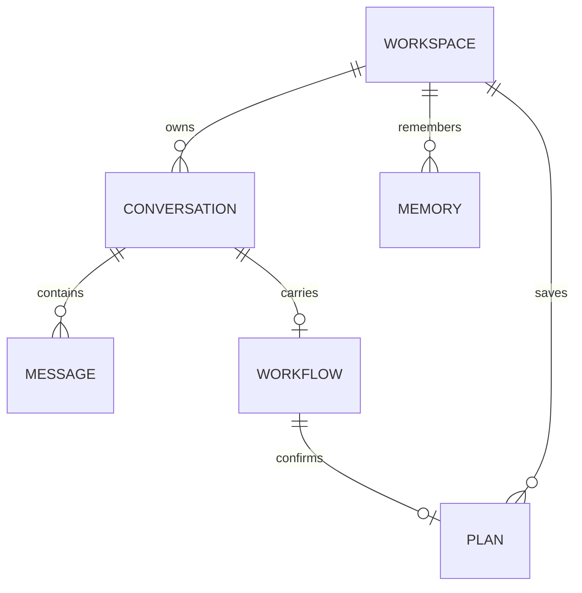
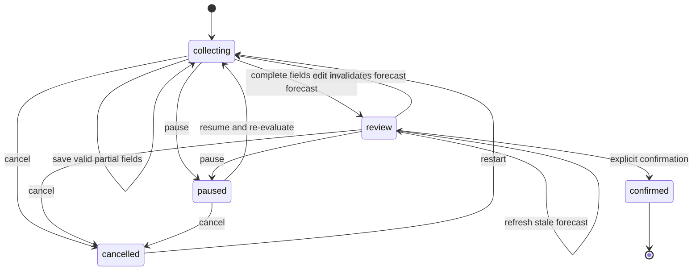

# Architecture

```text
Browser: voice capture, playback, English/Arabic UI
  → Next.js: interface and same-origin API proxy
    → FastAPI: workspace access, chat, memory, workflow state
      → PostgreSQL: durable conversations, facts, workflows, plans
      → Groq: chat, Whisper transcription, Orpheus speech
      → Open-Meteo: geocoding and forecasts
```

## Code map

| Area | Entry points |
|---|---|
| Interface and requests | `frontend/src/components/assistant.tsx`, `frontend/src/lib/api.ts` |
| Voice loop | `frontend/src/hooks/use-voice-session.ts`, `use-audio.ts` |
| Audio capture and playback | `frontend/src/lib/record-utterance.ts`, `voice-activity.ts`, `speech-output.ts` |
| HTTP and ownership checks | `backend/app/api.py` |
| Conversation behavior | `backend/app/services/chat.py` |
| Memory and previous outings | `backend/app/services/memory.py` |
| Planner state machine | `backend/app/services/workflow.py` |
| External requests | `backend/app/providers/groq.py`, `weather.py`, `http.py` |
| Persistence and validation | `backend/app/models.py`, `schemas.py`, `db.py`, `backend/alembic/` |

## Voice turn

`useVoiceSession` coordinates listen → transcribe → send → speak → listen. `recordUtterance` captures mono 16-bit PCM WAV with an AudioWorklet. A 1.3-second pause ends an utterance; initial silence is rejected locally, and recordings are bounded to 60 seconds. The backend checks waveform energy before calling Whisper, then checks provider confidence metadata. This prevents silent audio from becoming invented user messages without blacklisting legitimate phrases.

The microphone is closed during transcription, chat processing, and playback. A generation counter and abort signals prevent cancelled operations from sending late transcripts or reopening the microphone. Switching away from the tab ends the voice session.

The speech endpoint accepts an owned, persisted assistant message ID. It selects English or Saudi Arabic speech and splits long replies into bounded chunks. The browser plays them sequentially before listening again. A matching installed browser voice is the fallback when cloud speech fails.

## Data and isolation



The workspace cookie contains a random token; PostgreSQL stores its SHA-256 hash. Cookies are HttpOnly, SameSite Strict, and Secure on HTTPS. Every resource query checks workspace ownership. Supplying another workspace's conversation or memory ID returns 404.

A conversation contains messages and at most one workflow. Memory belongs to the workspace and is available across conversations. Confirmed plans store immutable snapshots of their slots, forecast, and proposal. Deleting a conversation cascades to its messages, workflow, and associated plan; independent memories remain.

Automatic memory extraction considers new personal statements only. A short, separate model call returns up to three candidate facts. The service accepts only allowed categories and exact quotes from the user's message, deduplicates facts, and replaces corrected identity/availability details. Explicit saves work without the model. Deleted memories are not regenerated by scanning older conversations.

Chat context includes the latest 30 non-error messages, up to 100 memories, and the latest 20 confirmed plans and 20 unfinished outings for the workspace. Older history remains stored. Memory extraction failure does not prevent the main conversation from continuing.

## Planner state



City, date, activities, and party size are required; notes are optional. Pydantic validates both form edits and model tool arguments. Weather is fetched only when the inputs are complete and valid in the destination's timezone.

The model can request a weather lookup or an outing update. It has no confirmation tool. Python controls state transitions and creates a saved plan only after explicit confirmation. Questions on other topics leave the workflow unchanged; pause and resume are durable actions.

An edit clears stale weather and recommendations before requesting new data. If the provider fails, valid edits remain saved and confirmation stays unavailable. Forecasts older than 30 minutes are refreshed and require another review. The proposal is a deterministic, weather-aware outline, without invented venues or reservations.

## Transactions and retries

Each write locks its workspace row in PostgreSQL, serializing concurrent mutations. A client UUID identifies a chat turn; repeated successful requests reuse the stored reply. An explicit retry of a failed turn keeps the original user message and replaces the error reply. Database uniqueness constraints also prevent duplicate messages and confirmations.

The database dependency uses FastAPI function scope so commits finish before success responses are sent. Recognized provider failures preserve valid workflow edits; unexpected exceptions roll back. Plan creation and workflow confirmation occur in one transaction.

External requests use finite HTTP phase timeouts. Connection failures and HTTP 429/500/502/503/504 receive at most three attempts with exponential backoff, jitter, and Retry-After handling. Authentication, validation, malformed payloads, and ambiguous read/write timeouts are not replayed. Memory extraction has one short attempt. The retry budget limits additional attempts; individual HTTP phase timeouts remain separately bounded.

Chat failures are saved as error messages and excluded from subsequent model context. Other endpoints return structured non-2xx errors. The interface translates public error codes into recovery instructions. Logs omit prompts, recordings, response bodies, and credentials.

## Runtime

Local Compose runs the frontend, API, and PostgreSQL separately. The root Dockerfile packages the frontend and API together for environments that provide PostgreSQL separately. Both application servers run as an unprivileged user; only the web port is exposed.

Alembic migrations run before startup, with a PostgreSQL advisory lock serializing migrators. Runtime table creation is not used. The process launcher stops the app if either server exits. CI verifies the production image's database-backed health endpoint as well as the local Compose and browser suites.

## Tradeoffs

Anonymous browser identity keeps session handling small but provides no account recovery or cross-device synchronization. Automatic memory is selective and depends on the provider; it is not a complete transcript archive. Energy-based turn detection is simple and inspectable, but noisy rooms and long pauses can affect it. Voice replies are sequential rather than streamed, and speaking does not interrupt playback. A per-workspace chat limit constrains ordinary usage but does not replace global cost controls.
